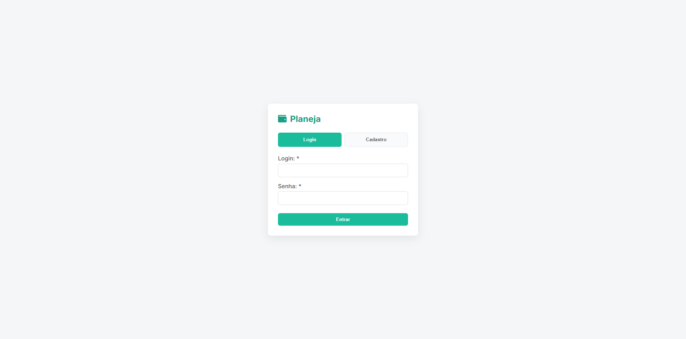
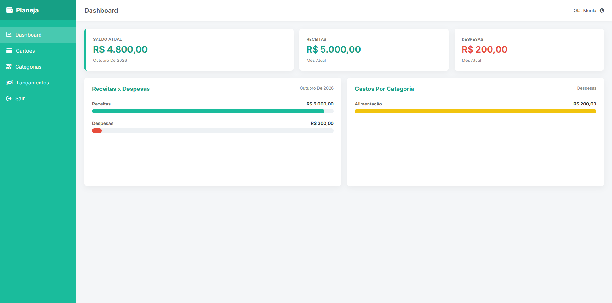
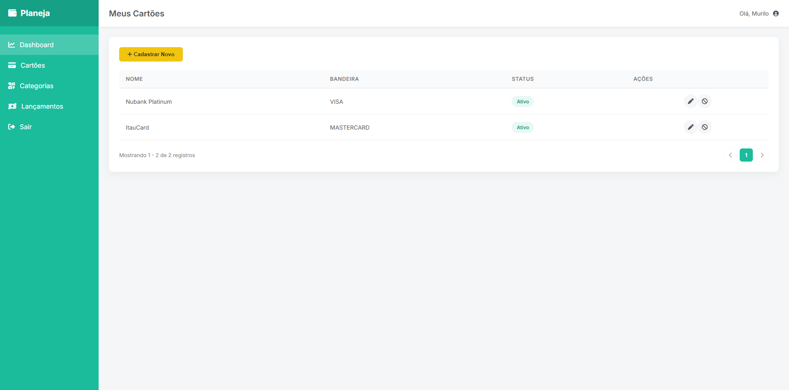
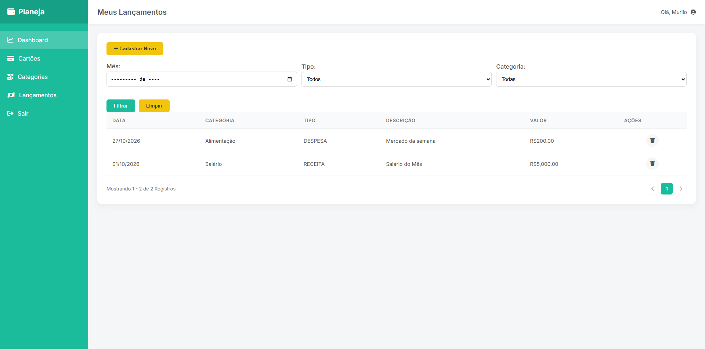

# Planeja — Aplicação Full Stack 🚀

Aplicação web para gerenciamento financeiro pessoal, desenvolvida durante os estudos de **Angular 21 e Spring Boot 4**, com integração entre front-end, API REST e banco de dados PostgreSQL.

O projeto tem como objetivo consolidar conhecimentos em desenvolvimento full stack, arquitetura de aplicações, implementação de regras de negócio, persistência de dados, autenticação e containerização com Docker.

## 🏗️ Arquitetura da aplicação

A aplicação é composta por um front-end desenvolvido com Angular e uma API REST construída com Spring Boot, seguindo a abordagem **Backend for Frontend (BFF)**.
```text
┌─────────────────────┐
│     Angular 21      │
│      Front-end      │
└──────────┬──────────┘
           │ HTTP / REST
           ▼
┌─────────────────────┐
│   Spring Boot 4     │
│     API / BFF       │
└──────────┬──────────┘
           │
           ▼
┌─────────────────────┐
│ Regras de negócio   │
│ Persistência de dados│
└──────────┬──────────┘
           │
           ▼
┌─────────────────────┐
│     PostgreSQL      │
└─────────────────────┘
```

### 💡 O que é BFF?

Backend for Frontend (BFF) é uma abordagem arquitetural na qual uma API é projetada para atender às necessidades específicas de um determinado front-end.

Nesse modelo, o Angular centraliza suas requisições na API Spring Boot, que processa as operações, aplica as regras necessárias e acessa os dados. Isso reduz o acoplamento do front-end aos detalhes internos do back-end e facilita a evolução das camadas da aplicação.

## 🛠️ Tecnologias utilizadas

### ⚙️ Back-end

- Java 25
- Spring Boot 4
- Spring Web
- Spring Data JPA
- Bean Validation
- MapStruct
- Lombok
- PostgreSQL
- H2 Database
- Maven

### 🎨 Front-end

- Angular 21
- TypeScript
- HTML e CSS
- Angular Router
- Angular Forms
- RxJS
- JWT
- ngx-mask
- ngx-toastr

### 🐳 Infraestrutura

- Docker
- Docker Network
- Containers para a API, o front-end e o banco de dados

## ✨ Funcionalidades

- Gerenciamento de cartões.
- Cadastro e listagem de categorias.
- Gerenciamento de lançamentos financeiros.
- Consulta de lançamentos com filtros e paginação.
- Validação de dados e tratamento de erros.
- Dashboard para visualização de informações financeiras.
- Cadastro e autenticação de usuários com JWT.
- Comunicação entre front-end e back-end por meio de APIs REST.

## 🖥️ Demonstração da aplicação

### 🔐 Login

Tela de autenticação para acesso à aplicação.



### 📊 Dashboard

Painel principal com a visualização das informações financeiras.



### 💳 Cartões

Interface para cadastro e gerenciamento de cartões.



### 💸 Lançamentos

Tela de consulta e gerenciamento de lançamentos financeiros.



## 📂 Estrutura do projeto

```text
Planeja-Api/
├── planeja-api/   # API REST com Java e Spring Boot
├── planeja-app/   # Front-end com Angular
└── README.md
```

## 🚀 Executando com Docker

O projeto pode ser executado em containers Docker. Os comandos abaixo consideram que os diretórios `planeja-api` e `planeja-app` possuem seus respectivos Dockerfiles e que a aplicação está configurada para utilizar os serviços da rede Docker.

### 📋 Pré-requisitos

- Docker instalado e em execução.
- Dockerfiles configurados para o back-end e o front-end.
- Configurações de conexão entre a API e o PostgreSQL.
- Configuração do front-end para acessar a API.

### 1\. 🌐 Criar a rede Docker

A rede permite a comunicação entre os containers utilizando seus nomes como endereços de serviço.

```bash
docker network create planeja-network
```

### 2\. 🐘 Subir o PostgreSQL

```bash
docker run -d \
  --name planeja-postgres \
  --network planeja-network \
  -p 5432:5432 \
  -e POSTGRES_DB=planeja \
  -e POSTGRES_USER=planeja \
  -e POSTGRES_PASSWORD=planeja123 \
  postgres:17-alpine
```

> As credenciais acima são destinadas exclusivamente ao ambiente local de estudo. Não reutilize essas credenciais em ambientes de produção.

### 3\. 📦 Construir a imagem da API

Na raiz do repositório:

```bash
docker build -t planeja-api ./planeja-api
```

### 4\. ⚙️ Executar a API Spring Boot

```bash
docker run -d \
  --name planeja-api \
  --network planeja-network \
  -p 8080:8080 \
  planeja-api
```

A API deve estar configurada para acessar o PostgreSQL pelo nome do container `planeja-postgres`, utilizando a porta interna `5432`.

### 5\. 📦 Construir a imagem do Angular

```bash
docker build -t planeja-app ./planeja-app
```

### 6\. 🌐 Executar o front-end

```bash
docker run -d \
  --name planeja-app \
  --network planeja-network \
  -p 4200:4200 \
  planeja-app
```

O container do Angular precisa estar configurado para escutar na porta `4200`. Caso utilize um servidor de produção diferente do servidor de desenvolvimento do Angular, ajuste o mapeamento de portas conforme o Dockerfile.

### 🔗 Endereços de acesso

| Serviço | Endereço |
| --- | --- |
| Front-end | http://localhost:4200 |
| API REST | http://localhost:8080 |
| PostgreSQL | localhost:5432 |

**Importante:** os comandos demonstram a execução individual dos containers. Para que a aplicação funcione de ponta a ponta, a API precisa usar o endereço interno do PostgreSQL na rede Docker, enquanto o Angular precisa estar configurado para enviar as requisições ao endereço correto da API.

## 🎯 Objetivos de aprendizado

O desenvolvimento do Planeja permite praticar conceitos de desenvolvimento de software, incluindo:

- Arquitetura em camadas e separação de responsabilidades.
- Construção e consumo de APIs REST.
- DTOs, validação e mapeamento de objetos.
- Persistência de dados com Spring Data JPA.
- Integração entre Angular e Spring Boot.
- Autenticação baseada em JWT.
- Consultas dinâmicas, filtros e paginação.
- Containerização e comunicação entre serviços com Docker.
- Organização e manutenção de uma aplicação full stack.

## 📚 Contexto do projeto

Projeto desenvolvido durante o curso **Angular 21 + Spring Boot 4 Fullstack do Zero ao Profissional**, da Udemy, com foco na aplicação prática dos conceitos estudados.

## 👨‍💻 Autor

**Murilo Pizolito**

- GitHub
- LinkedIn